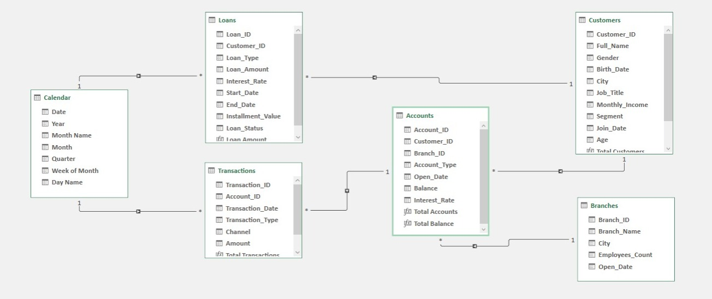
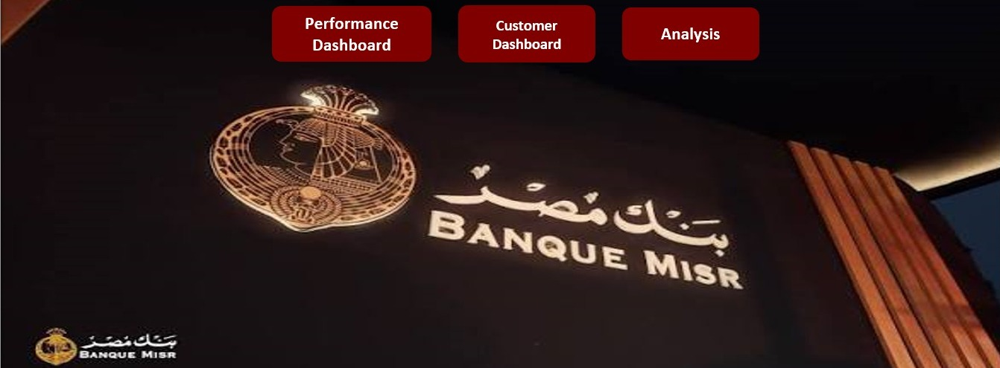
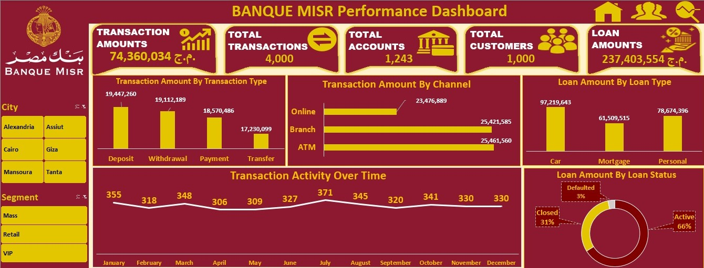
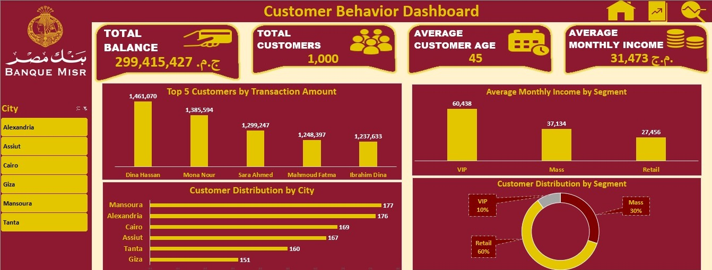
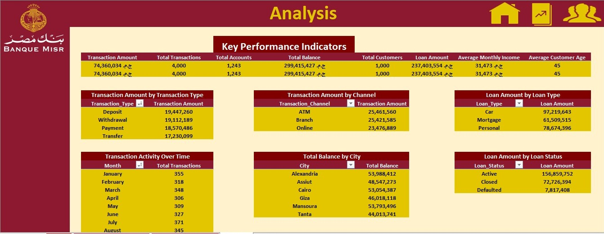

<div align="center">

# 🏦 Banque Misr — Data Analysis Project

### An Interactive Banking Data Analysis & Dashboard Solution Using Microsoft Excel

**Transforming Banque Misr banking data into meaningful business insights.**

[](https://www.microsoft.com/microsoft-365/excel)
[](https://learn.microsoft.com/power-query/)
[](https://support.microsoft.com/excel)
[](https://learn.microsoft.com/dax/)

</div>

---

# 📌 Project Overview

This project was developed as part of my **Data Analysis Diploma at Route Academy**, focusing on analyzing banking data associated with Banque Misr.

The objective was to transform raw banking data into an interactive Excel-based analytical solution that provides insights into customer characteristics, account balances, transaction activity, and the loan portfolio.

The project demonstrates the application of data cleaning, transformation, data modeling, DAX calculations, and interactive dashboard development to address business questions relevant to banking operations.

The final workbook includes a navigation interface, a performance dashboard, a customer behavior dashboard, and a supporting analysis sheet.

---

# 🎯 Business Objectives

The project focuses on exploring the following business questions:

- What is the total transaction amount and how many transactions were recorded?
- How does transaction value vary across transaction types and channels?
- How does transaction activity change over time?
- How is the loan portfolio distributed across loan types and loan statuses?
- How are customers distributed across cities and customer segments?
- Which five customers have the highest total transaction amounts?
- How does monthly income vary across customer segments?
- What are the key characteristics of the customer base?

These analyses aim to provide a structured view of the supplied Banque Misr dataset and support data-driven business discussions.

---

# 🧰 Tools & Technologies

| Tool / Technology | Purpose |
|---|---|
| **Microsoft Excel** | Data analysis, dashboard development, and reporting |
| **Power Query** | Data import, cleaning, transformation, and validation |
| **Power Pivot** | Data modeling and relationship management |
| **DAX** | Creating analytical measures and calculated customer age |
| **Excel Data Model** | Connecting multiple tables for integrated analysis |
| **PivotTables** | Summarizing data and calculating analytical results |
| **Pivot Charts** | Visualizing transaction, customer, and loan analysis |
| **Slicers** | Providing interactive filtering across dashboards |
| **Navigation Buttons** | Enabling navigation between workbook pages |
| **Excel Charts** | Presenting KPIs, comparisons, distributions, and trends |

---

# 🗂️ Dataset Overview

The project uses five main source tables representing different aspects of the supplied Banque Misr banking dataset.

| Table | Description | Analytical Purpose |
|---|---|---|
| `Customers` | Customer details, including city, gender, birth date, segment, and monthly income | Customer demographics and segment analysis |
| `Accounts` | Account type, opening date, balance, interest rate, and related customer and branch | Account balance and account analysis |
| `Branches` | Branch details, including branch name, city, and employee count | Branch reference information |
| `Transactions` | Transaction date, type, channel, account, and amount | Transaction value and activity analysis |
| `Loans` | Loan type, amount, interest rate, dates, installment value, and loan status | Loan portfolio analysis |

A Calendar table was also created to support date-based analysis.

---

# 🧹 Data Cleaning & Transformation

Power Query was used to import, prepare, and validate the five source tables before loading them into the Excel Data Model.

### Data Preparation Steps

- Reviewed and assigned appropriate data types to columns.
- Checked data completeness and errors.
- Validated primary keys and checked for duplicate values.
- Checked for duplicate full rows.
- Validated foreign-key values against their related tables.
- Reviewed categorical values for inconsistent spelling or formatting.
- Prepared the tables for data modeling and analysis.

These steps helped establish a consistent data foundation for the Banque Misr analysis.

---

# 🔗 Data Model & Relationships

Power Pivot was used to build a relational data model connecting the five source tables with a Calendar table.

### Main Relationships

| One-Side Table | Many-Side Table | Relationship Key |
|---|---|---|
| Customers | Accounts | `Customer_ID` |
| Customers | Loans | `Customer_ID` |
| Branches | Accounts | `Branch_ID` |
| Accounts | Transactions | `Account_ID` |
| Calendar | Transactions | `Date` → `Transaction_Date` |
| Calendar | Loans | `Date` → `Start_Date` |

The model enables related banking information to be analyzed across customers, accounts, transactions, branches, and loans.

The Calendar table supports date-based analysis of transactions and loan start dates.

### Data Model Preview



---

# 📊 Dashboards

The Excel workbook contains a navigation interface, two analytical dashboards, and an Analysis sheet with supporting PivotTables.

## 🏠 1. Home Page

The Home page serves as the main navigation interface for the Banque Misr project.

It includes navigation buttons that allow users to move between:

- Performance Dashboard
- Customer Behavior Dashboard
- Analysis & Reports

This provides a simple and user-friendly way to explore the different parts of the workbook.



---

## 🏦 2. Banque Misr Performance Dashboard

The **Banque Misr Performance Dashboard** provides an overview of transaction activity and the loan portfolio in the supplied dataset.

### Key Performance Indicators (KPIs)

| KPI | Result |
|---|---:|
| Transaction Amount | EGP 74,360,034 |
| Total Transactions | 4,000 |
| Total Accounts | 1,243 |
| Total Customers | 1,000 |
| Loan Amount | EGP 237,403,554 |

### Analysis Included

**Transaction Analysis**
- Transaction Amount by Transaction Type
- Transaction Amount by Channel
- Transaction Activity Over Time

**Loan Portfolio Analysis**
- Loan Amount by Loan Type
- Loan Amount by Loan Status

The dashboard uses charts and interactive slicers to explore transaction activity and loan portfolio composition.

The goal is to make key metrics and comparisons easy to understand at a glance.



---

## 👥 3. Customer Behavior Dashboard

The **Customer Behavior Dashboard** focuses on customer characteristics, geographic distribution, and financial activity.

### Key Performance Indicators (KPIs)

| KPI | Result |
|---|---:|
| Total Balance | EGP 299,415,427 |
| Total Customers | 1,000 |
| Average Customer Age | 45 |
| Average Monthly Income | EGP 31,473 |

### Analysis Included

- Top 5 Customers by Transaction Amount
- Customer Distribution by City
- Customer Distribution by Segment
- Average Monthly Income by Segment

These analyses provide insights into the customer base, geographic concentration, customer segments, and transaction activity at the individual customer level.

Note: The Average Monthly Income KPI is calculated using the median rather than the mean to reduce the influence of extreme income values and provide a more representative measure of a typical customer's monthly income.

Interactive filters allow users to explore the available customer and financial dimensions supported by the data model.



---

## 📑 4. Analysis & Reports

The Analysis sheet contains the supporting KPI summary and PivotTables used to feed the dashboards.

It organizes the calculations and summaries behind the visualizations, including transaction, customer, account, balance, and loan analysis.

This sheet acts as the analytical foundation for the dashboards and helps keep the reporting process organized.



---

# 💡 Key Business Findings

Based on the dashboard outputs, the supplied dataset contains the following results:

| Metric | Result |
|---|---:|
| Total Transaction Amount | EGP 74,360,034 |
| Total Transactions | 4,000 |
| Total Customers | 1,000 |
| Total Accounts | 1,243 |
| Total Loan Amount | EGP 237,403,554 |
| Total Account Balance | EGP 299,415,427 |

### Customer Segment Distribution

The Customer Behavior Dashboard shows the following distribution:

- **Retail:** 60%
- **Mass:** 30%
- **VIP:** 10%

Retail customers represent the largest customer segment in the supplied dataset.

### Additional Analytical Perspectives

The dashboards also provide comparisons of:

- Transaction amounts across transaction types.
- Transaction amounts across transaction channels.
- Monthly transaction activity.
- Loan amounts across loan types and loan statuses.
- Customer distribution across cities.
- Transaction amounts for the top five customers.
- Monthly income across customer segments.

Together, these views provide a structured overview of the supplied dataset and demonstrate how Excel can be used to explore banking performance and customer characteristics.

---

# 📁 Repository Structure

The repository is organized as follows:

```text
Banque_Misr_Data_Analytics/
│
├── Bank_Misr_Data_Analysis_Dashboard.xlsx
├── README.md
│
├── Bank_Misr_Data_Source/
│   ├── Accounts.csv
│   ├── Branches.csv
│   ├── Customers.csv
│   ├── Loans.csv
│   └── Transactions.csv
│
└── Screenshots/
    ├── Analysis_Page.jpeg
    ├── Customer_Dashboard.jpeg
    ├── Data_Model.jpeg
    ├── Home_Page.jpeg
    └── Performance_Dashboard.jpeg
```

---

# 🚀 How to Open the Project

Clone the repository:

```bash
git clone git@github.com:MohamedAlaaWork33/Banque_Misr_Data_Analytics.git
```

Open **Bank_Misr_Data_Analysis_Dashboard.xlsx** using Microsoft Excel.

Make sure the workbook and the `Screenshots` folder are located in the repository as shown above so that the screenshots display correctly on GitHub.

---

# 📧 Contact

**Mohamed Alaa**

Computer Science Graduate | Aspiring Data Analyst

📧 **Email**  
mohamedalaawork33@gmail.com

💻 **GitHub**  
https://github.com/MohamedAlaaWork33

🔗 **LinkedIn**  
https://www.linkedin.com/in/mohamed-alaa-1a283a230/

---